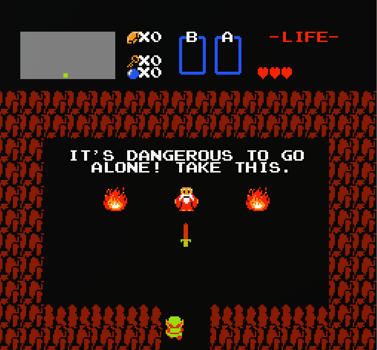
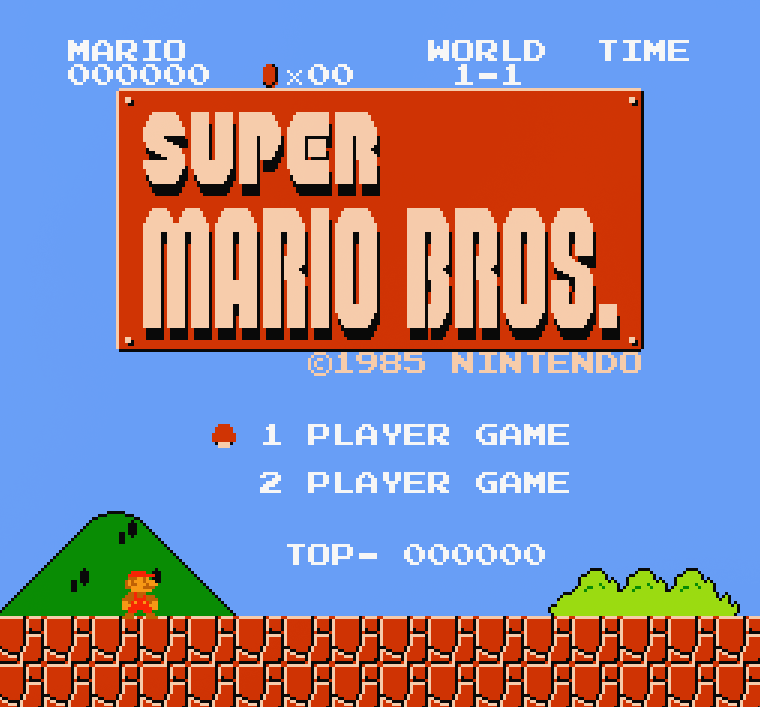
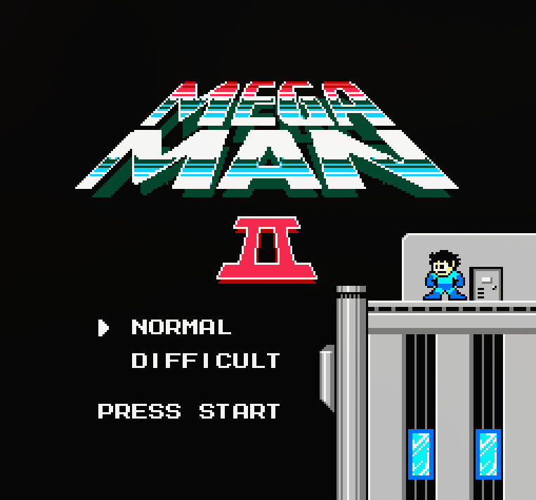

# Project G

NES Hobby Emulator written in Rust.







## Summary

- [Disclaimers](#disclaimers)
- [Architecture](#architecture)
- [Commands](#commands)
- [Acknowledgments](#acknowledgments)

## Disclaimers

First of all the Nintendo Entertainment System is a video game console created and developed by Nintendo. The aim of this code is only to emulate the behaviour of this console. You should own a copy of the games you play  on this emulator :).

This emulator is a hobby emulator I built during my free time as a side project. It is **NOT** a high end emulator, the main philosophy while building Project G was to be somehow in the middle between fidelity to the original hardware and fully optimizing the gaming experience. Please note that Project G is my first emulator project, the goal of it was mostly educational and to learn more about emulators & old hardware.

There are quite a few known issues with the emulator, here's a non-exhaustive list:

- Metallic sound (Dmc & Noise sound modules are not implemented yet it is WIP and improvments need to be made on sound mixing)
- No second controller support
- Not all NES games are compatible with Project G (for now only **Mapper 0** & **most of Mapper 1** games are compatible)
- ...

## Architecture

The main architecture follows the main structure from [this great guide](https://bugzmanov.github.io/nes_ebook/chapter_1.html) made by Bugzmanov.
First we start with a *CPU* which is an emulator of the 6502 processor used in the NES. The CPU handles the gameloop and owns the *Bus* which is the spine of the system, it owns the *PPU* (Picture Processing Unit), the *APU* (Audio Processing Unit), the *Joypad*, the cycles, the rendering, the audio output. The *ROM* contains all game data, and how it is managed by the system. It is both owned by the PPU and the Bus.

At the same time, we have a `config.toml` file sitting in config path, containing the path to the loaded rom and the controls mapping. Note that all your rom files must sit in a `rom` folder in your current work directory.

About the dependencies, the UI for loading a rom is using *Ratatui*, the audio is processed using *cpal*, the CLI is made using *clap* and the graphical rendering is made with *sdl2*. The dependencies are managed with *Cargo*.

## Commands

Here are the commands of Project G:

```shell
load-rom
```

This command is for loading a `.nes` file. The files must be placed in a rom folder in your current work directory!

```shell
get-rom-infos
```

This command some data about the loaded rom, such as the mapper number, the PRG ROM size & the CHR ROM size.

```shell
play
```

This command is for playing the loaded rom (who could have guessed ?)

## Acknowledgments

- Huge thanks to Bugzmanov for his [*Writing NES Emulator in Rust*](https://bugzmanov.github.io/nes_ebook/chapter_1.html) guide, I used their structure to kickstart the project.

- Many thanks to [*Nesdev Wiki*](https://www.nesdev.org/wiki/Nesdev_Wiki) for all the data about the small (and huge) details of the NES, and especially 6502 assembler.

- Thanks to [*Nes Directory*](https://github.com/nesdir/nesdir.github.io) for the data about game roms.
